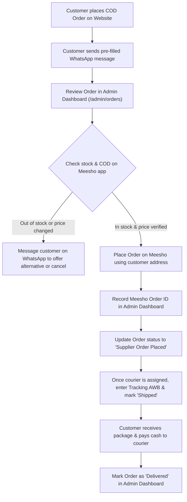

# Nammude Picks — Curated E-Commerce & Admin Portal for Kerala

[](https://vitejs.dev/)
[](https://react.dev/)
[](https://tailwindcss.com/)
[](https://supabase.com/)
[](https://pages.cloudflare.com/)

A complete, free, mobile-first e-commerce website and secure admin management portal built specifically for curated reselling in Kerala, India.

> **Independent Store Disclaimer:**  
> Nammude Picks is an independent curated online storefront. We handpick quality products, manually verify orders, and fulfill them via reputable Indian wholesale suppliers and manufacturers (including Meesho reseller fulfillment where permitted). Nammude Picks is **not** officially affiliated with, endorsed by, or operated by Meesho.

---

## Table of Contents

1. [Features Overview](#1-features-overview)
2. [Project Architecture](#2-project-architecture)
3. [Quick Local Setup (Run in 2 Minutes)](#3-quick-local-setup-run-in-2-minutes)
4. [Setting Up Free Supabase Backend & Database](#4-setting-up-free-supabase-backend--database)
5. [Creating Your First Admin Account](#5-creating-your-first-admin-account)
6. [Deploying Free to Cloudflare Pages](#6-deploying-free-to-cloudflare-pages)
7. [Manual Meesho Fulfilment Workflow (SOP)](#7-manual-meesho-fulfilment-workflow-sop)
8. [Store Customisation Guide](#8-store-customisation-guide)
9. [Pre-Launch Verification Checklist](#9-pre-launch-verification-checklist)

---

## 1. Features Overview

### Customer Storefront (Mobile-First for Kerala)
- **Malayalam-Friendly Branding:** Warm neutral aesthetics, refined forest green accents, and curated everyday finds.
- **100% Cash on Delivery (COD):** Zero online payment gateway fees or customer friction; pay cash upon parcel delivery.
- **Kerala Coverage:** Pre-configured for all 14 districts (Kasaragod to Thiruvananthapuram) with postal PIN validation.
- **WhatsApp Order Requests:** Formats standard COD order requests with reference number, complete address, and item list, then opens WhatsApp with one click. Fallback clipboard copying included.
- **Persistent Shopping Bag:** Cart items and quantities persist across page refreshes via browser `localStorage` (customer personal address and phone data are **never** stored in localStorage for privacy).
- **Search & Filtering:** Real-time search, category filters, price slider (e.g., Under ₹499 Corner), and sorting.
- **Static & Free:** Built with zero paid APIs, zero paid database requirements, and zero runtime servers.

### Secure Admin Management Portal (`/admin`)
- **Direct Access Only:** The admin login route (`/admin/login`) is not linked in public storefront navigation.
- **Overview Dashboard:** Live KPI cards for Total Orders, New Requests, Awaiting Customer Confirmation, In Fulfilment, Delivered Orders, Cancelled Orders, and Delivered Sales Revenue in ₹ INR.
- **Inventory Alerts:** Real-time notifications for low-stock and out-of-stock items.
- **Product Management:** Add, edit, archive, and delete products. Set public selling prices, compare-at prices, variants, stock, and upload images.
- **Private Supplier Protection (RLS):** Confidential supplier costs in INR and private supplier URLs (e.g. Meesho product links) are stored in a protected table accessible **only** to authenticated administrators.
- **Order Fulfilment Console:** 10-stage order lifecycle management, internal admin notes, supplier order ID tracking, courier AWB numbers, and one-click WhatsApp customer status updates.
- **Store Settings:** Live editing for store name, tagline, WhatsApp business number, Instagram URL, announcement banner, and Kerala delivery fees.
- **Graceful Dual-Mode Support:** Works out-of-the-box in local preview mode and connects automatically to Supabase PostgreSQL once `.env` credentials are added.

---

## 2. Project Architecture

```
Meesho/
├── public/
│   ├── favicon.svg            # Custom shopping bag SVG favicon
│   └── _redirects             # Cloudflare Pages SPA client-side routing
├── src/
│   ├── admin/                 # Admin Dashboard Module
│   │   ├── AdminLayout.jsx    # Responsive sidebar layout & protected route wrapper
│   │   ├── AdminLogin.jsx     # Admin auth screen with Supabase Auth
│   │   ├── AdminOverview.jsx  # KPI metrics, low-stock alerts, recent orders
│   │   ├── AdminProducts.jsx  # Catalog management with private supplier cost fields
│   │   ├── AdminOrders.jsx    # Order fulfillment console & WhatsApp updates
│   │   └── AdminSettings.jsx  # Store details, WhatsApp number, delivery charge
│   ├── components/            # Reusable UI Components
│   │   ├── Navbar.jsx         # Announcement bar, logo, search, category nav
│   │   ├── Footer.jsx         # Value props, policies, disclaimer, contact
│   │   ├── ProductCard.jsx    # Pricing, discount badges, COD buy button
│   │   ├── CartDrawer.jsx     # Slide-over cart, free delivery progress meter
│   │   ├── PublicLayout.jsx   # Storefront wrapper
│   │   ├── ScrollToTop.jsx    # Window position reset on navigation
│   │   └── InstagramIcon.jsx  # Clean SVG Instagram icon
│   ├── config/
│   │   └── storeConfig.js     # Central business configuration file
│   ├── context/
│   │   ├── AuthContext.jsx    # Supabase authentication session state
│   │   └── CartContext.jsx    # Shopping bag calculations & localStorage sync
│   ├── data/
│   │   └── products.js        # 12 Initial Kerala demo products & sanitizer
│   ├── lib/
│   │   ├── supabase.js        # Supabase client initializer
│   │   └── dataService.js     # Unified data layer (Supabase + local fallback)
│   ├── pages/                 # Storefront Pages
│   │   ├── Home.jsx           # 14-section homepage with hero & reels hooks
│   │   ├── Shop.jsx           # Product catalog with search and filters
│   │   ├── ProductDetails.jsx # Image gallery, variants, COD reassurance
│   │   ├── CartPage.jsx       # Full-page shopping cart
│   │   ├── Checkout.jsx       # Kerala COD form & WhatsApp message generator
│   │   ├── AboutUs.jsx        # Story, curation ethos & supplier disclosure
│   │   ├── ContactUs.jsx      # WhatsApp support & customer care hours
│   │   ├── ShippingPolicy.jsx # Kerala delivery timelines (3-7 days)
│   │   ├── ReturnsPolicy.jsx  # 5-day replacement & unboxing video clause
│   │   ├── PrivacyPolicy.jsx  # Zero-localStorage address policy
│   │   ├── Terms.jsx          # Reseller terms & liability limitations
│   │   ├── FAQPage.jsx        # Categorized shopping & COD FAQs
│   │   └── NotFound.jsx       # 404 page
│   ├── utils/
│   │   └── orderUtils.js      # WhatsApp order text formatter & INR currency
│   ├── App.jsx                # Application router
│   ├── index.css              # Tailwind CSS directives & scrollbar styles
│   └── main.jsx               # React 19 entry point
├── supabase/
│   └── schema.sql             # Complete PostgreSQL schema & Row Level Security (RLS)
├── .env.example               # Safe environment variable template
├── .gitignore                 # Protected git ignore rules
├── index.html                 # SEO & Open Graph metadata for Reels/Ads
├── package.json               # Dependencies and scripts
├── postcss.config.js          # PostCSS configuration
├── tailwind.config.js         # Custom Kerala palette and typography
└── vite.config.js             # Vite build configuration
```

---

## 3. Quick Local Setup (Run in 2 Minutes)

### Prerequisites
- Node.js version 18 or higher (`node -v`)
- npm version 9 or higher (`npm -v`)

### Steps

1. **Clone or open the repository folder:**
   ```bash
   cd c:/Users/Jayas/PycharmProjects/Meesho
   ```

2. **Install project dependencies:**
   ```bash
   npm install
   ```

3. **Start the local development server:**
   ```bash
   npm run dev
   ```

4. **Open in your browser:**
   - Public Storefront: [http://localhost:5173/](http://localhost:5173/)
   - Admin Portal: [http://localhost:5173/admin/login](http://localhost:5173/admin/login)

> **Local Demo Mode:**  
> When running without a configured `.env` file, the app automatically runs in local preview mode. You can test the Admin Portal using:  
> - **Email:** `admin@nammudepicks.in`  
> - **Password:** `admin123`

5. **Verify the Production Build:**
   ```bash
   npm run build
   ```
   The build will generate optimized static assets in the `dist/` directory.

---

## 4. Setting Up Free Supabase Backend & Database

Supabase provides a generous free tier (PostgreSQL database, Authentication, and Storage) that costs ₹0.

### Step 1: Create a Free Supabase Project
1. Go to [https://supabase.com](https://supabase.com) and sign up for a free account.
2. Click **New Project**.
3. Choose a name (e.g. `nammude-picks`), set a secure database password, and select region **South Asia (Mumbai)** for lowest latency to Kerala customers.
4. Wait 1-2 minutes for the database to provision.

### Step 2: Configure Environment Variables
1. In your Supabase Project Dashboard, navigate to **Project Settings** (gear icon) -> **API**.
2. Copy the **Project URL** and the **anon (public)** key.
3. In your project root, create a file named `.env`:
   ```env
   VITE_SUPABASE_URL=https://your-project-id.supabase.co
   VITE_SUPABASE_ANON_KEY=your-supabase-public-anon-key-here
   ```
   *(Never use your `service_role` secret key in the frontend).*

### Step 3: Run the Database Schema & Security Policies
1. In the Supabase Dashboard, click on **SQL Editor** in the left sidebar.
2. Open the file [`supabase/schema.sql`](file:///c:/Users/Jayas/PycharmProjects/Meesho/supabase/schema.sql) in this repository.
3. Copy the entire contents and paste into the Supabase SQL Editor.
4. Click **Run**.

This automatically creates:
- `products`: Publicly viewable catalog with price and variants.
- `product_supplier_info`: **Strictly protected** table for private supplier costs and Meesho URLs (RLS blocks all unauthenticated read access).
- `orders`: Stores customer COD requests. Public visitors can only insert their own new order; only authenticated admins can view and manage orders.
- `order_items`: Order line items with quantities and prices.
- `store_settings`: Dynamic store configuration.
- `product-images` storage bucket: Configured with policies allowing public image viewing and admin-only image uploads.

---

## 5. Creating Your First Admin Account

1. In your Supabase Dashboard, go to **Authentication** -> **Users**.
2. Click **Add User** -> **Create User**.
3. Enter your own email (e.g., `you@gmail.com`) and a strong password.
4. Ensure **Auto Confirm User** is checked.
5. Click **Create User**.
6. Now go to `http://localhost:5173/admin/login` (or your live site URL `/admin/login`) and sign in with this email and password!

---

## 6. Deploying Free to Cloudflare Pages

Cloudflare Pages provides free unlimited static website hosting with global CDN, free SSL certificates, and zero bandwidth limits.

### Method A: Deploy via GitHub (Recommended)
1. Push this project to your GitHub repository:
   ```bash
   git init
   git add .
   git commit -m "Initial commit of Nammude Picks e-commerce store"
   git remote add origin https://github.com/your-username/nammude-picks.git
   git push -u origin main
   ```
2. Log in to [Cloudflare Dashboard](https://dash.cloudflare.com/) -> **Compute (Workers & Pages)** -> **Create Application** -> **Pages** -> **Connect to Git**.
3. Select your repository.
4. In Build Settings:
   - **Framework preset:** `Vite`
   - **Build command:** `npm run build`
   - **Build output directory:** `dist`
5. In **Environment Variables**, add:
   - `VITE_SUPABASE_URL`: Your Supabase URL
   - `VITE_SUPABASE_ANON_KEY`: Your Supabase public anon key
6. Click **Save and Deploy**. Your site will be live on a free `*.pages.dev` subdomain in less than 2 minutes!

### Method B: Direct Upload via Cloudflare Wrangler CLI
```bash
npm run build
npx wrangler pages deploy dist --project-name nammude-picks
```

*(The included `public/_redirects` file automatically handles single-page app routing so that visiting any sub-route directly never results in a 404).*

---

## 7. Manual Meesho Fulfilment Workflow (SOP)

This business model operates as an independent, transparent reselling service. Follow this step-by-step Standard Operating Procedure (SOP):



### Detailed Operator SOP:
1. **Receive Order Request:**  
   The customer fills out the checkout form and clicks *Send COD Order via WhatsApp*. The order is logged in your Admin Dashboard under status **New Request**.
2. **Customer Verification:**  
   Review the customer's delivery address and district. Click **Send WhatsApp Status Update** in the Admin Order Drawer to confirm they intended to place the order.
3. **Supplier Verification on Meesho:**  
   Open the private supplier URL saved on the product in your Admin Console. Verify:
   - Is the exact color/size variant currently in stock?
   - Is the supplier cost still within your margin expectations?
   - Is COD delivery supported for the customer's 6-digit Kerala PIN code?
4. **Place Order on Meesho:**  
   In the Meesho app, add the item to cart. Enter the customer's name, phone number, and delivery address. Select Cash on Delivery. Add your reseller margin if using Meesho's customer margin feature, or order at cost and fulfill directly.
5. **Record Supplier Reference:**  
   In your Admin Order Drawer, paste the Meesho Order ID (e.g., `MSH-901827361`) and save. Update status to **Supplier Order Placed**.
6. **Track & Update Customer:**  
   When the supplier dispatches the parcel, copy the courier tracking AWB (Delhivery, Shadowfax, Xpressbees, etc.) into the Admin Order Drawer. Click the WhatsApp button to notify the customer that their package is in transit with estimated delivery in 3 to 7 days.
7. **Delivery & Completion:**  
   Once the courier marks the package delivered and the customer pays cash, update status to **Delivered**. The Delivered Sales KPI card updates immediately.
8. **Handling Returns & Complaints:**  
   If a customer reports an issue within 5 days, request their unedited 360° unboxing video. Use this video to claim a replacement or refund with the supplier on Meesho.

---

## 8. Store Customisation Guide

### Changing WhatsApp Number & Business Details
You can change store details in two ways:
1. **Via Admin Dashboard:** Go to `/admin/settings`, enter your actual WhatsApp number (e.g. `919847123456`), and click **Save Settings**.
2. **Via Code Default:** Edit [`src/config/storeConfig.js`](file:///c:/Users/Jayas/PycharmProjects/Meesho/src/config/storeConfig.js):
   ```javascript
   whatsappNumber: '919847123456', // Format: 91 followed by 10 digits
   whatsappDisplay: '+91 98471 23456',
   instagramUrl: 'https://instagram.com/yourhandle',
   ```

### Adding New Products & Changing Prices
- Go to `/admin/products`.
- Click **Add New Product** or click **Edit** on any existing item.
- Upload product images, set your selling price in INR, set compare-at prices, and add variants.
- Store your confidential supplier cost and Meesho URL in the protected fields.
- The storefront updates automatically!

### Replacing Demo Photos
Demo photos in `src/data/products.js` use high-resolution Unsplash product photography. When listing your own items:
- Use photos provided by your supplier or take clean photos against a well-lit white/neutral background.
- Upload them directly through the Admin Product form or save them in `public/products/`.

---

## 9. Pre-Launch Verification Checklist

Before running Meta ad campaigns, posting Instagram Reels, or accepting customer orders, verify every item on this checklist:

- [ ] **WhatsApp Number Configured:** Test sending a test order from your phone to ensure the WhatsApp message opens your correct business number.
- [ ] **Phone & PIN Code Validation:** Verified that 10-digit mobile numbers and 6-digit PIN codes are required at checkout.
- [ ] **Pricing Verification:** Ensure selling prices cover the supplier cost plus courier shipping fee (standard ₹49) plus your desired profit margin.
- [ ] **Districts Verified:** Confirmed all 14 Kerala districts are listed in the checkout dropdown.
- [ ] **Supplier Return Window:** Checked the return window and unboxing video requirements on Meesho for the specific suppliers you list.
- [ ] **Supabase Admin User Created:** Created your personal admin user in Supabase Authentication and verified login at `/admin/login`.
- [ ] **Cloudflare Pages Deployed:** Verified that navigating to sub-routes (e.g. `/shop`, `/cart`, `/checkout`) works on page refresh without 404 errors.
- [ ] **Independent Store Disclaimer Visible:** Confirmed that the store footer and policy pages state clearly that Nammude Picks is an independent store and not officially affiliated with Meesho.
- [ ] **Tested on Mobile Browser:** Opened the website on a smartphone screen to verify sticky buttons, cart drawer, and readable Malayalam-friendly fonts.

---

## License

This project is created for personal and commercial reselling under the MIT License.
